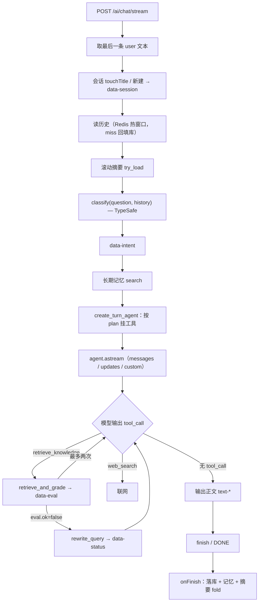

# Agentic RAG 流程

> 对应 TS：`src/ai/ai-stream.service.ts`、`chat-query-rewrite.service.ts`、`agentic-retrieve.ts`
> 对应 Python：
> - 编排：`backend/app/services/ai_stream.py`
> - 意图 / 评估 / 改写：`backend/app/services/chat_query_rewrite.py`
> - 检索 + 评估原子：`backend/app/services/agentic_retrieve.py`
> - 混合检索：`backend/app/services/retrieval.py`
> - 示意图：`docs/agenticRag.png`
>
> 状态：已实现并冒烟通过（后端 agentic 检索循环 + 前端过程条）；事件契约以本文为准。

---

## 1. 一句话

把「检索」从**请求前的固定一步**改成**模型可以反复调用的工具**：模型先检索一次 → 看切题评估 → 不切题就先改写检索词再查一次（最多两次）→ 仍不足才联网 → 全程把 `data-*` 事件推给前端过程条。

主动作不再是「代码查一次塞进 prompt」，而是「模型按 Agentic RAG 循环自己调度」。

---

## 2. 和「预取 RAG」的区别

| | 预取 RAG（旧） | Agentic RAG（现） |
|---|---|---|
| 检索时机 | agent 之前，固定一次 | agent 循环内，模型决定 |
| 谁决定重试 | 代码写死一次纠正重试 | 模型（看 `eval.ok` / `insufficient`） |
| 多跳 | 不支持 | 支持（检索→改写→再检索） |
| 工具 | 只有 `web_search` | `retrieve_knowledge` / `rewrite_query` / `retrieve_graph` / `web_search` |
| 意图 | `classify` 没接主流程 | `classify` 决定挂哪些工具 + `data-intent` |
| 延迟 | 可预测 | 多轮模型调用，较高 |
| 可复现 | 强 | 弱（模型自主） |

---

## 3. 总链路



文字版事件序列：

```
start → data-session → data-status(intent) → data-intent
      → [ data-eval → data-sources → source-document* ]   # agentic 循环，按需
      → [ tool-input-* / tool-output-* / reasoning-* / text-* ]
      → finish → [DONE]
```

---

## 4. 逐阶段详解

### 4.1 会话与历史

- `last_user_text(dto.messages)` 取本轮问题；空问题直接回「请输入问题。」不建会话。
- 有 `sessionId` → `touch_title`（默认标题时用首问覆盖）；否则 `create`。
- 历史：`load_working_history` 先读 Redis 热窗口，miss 才查库回填。
  - ⚠️ 用 `is not None` 判断命中，不能用真值判断（`save([])` 后是「命中但空」而非 miss）。

### 4.2 意图路由（`classify`，TypeSafe）

在 agent 之前跑一次，产出 `ChatRoutePlan`：

```python
{ "intent": "kb" | "chitchat" | "profile" | "web" | "kb_then_web",
  "label": "知识库",
  "query": "差旅审批流程",           # 建议检索词（知识库用）
  "graph_queries": ["差旅", "审批"],   # 图谱短实体名（仅 kb）
  "allow_retrieve": True,
  "allow_graph": True,             # 与 allow_retrieve 相同
  "allow_web": False }
```

分工（路线 A：**TypeSafe 管决策、LLM 管生成**）：

| 判定 | 原语 | 说明 |
|---|---|---|
| 意图 | TypeSafe `Choice`（5 路） | 判别式，便宜快 |
| 是否要改写 | TypeSafe `Choice`（3 路：standalone / needs_context / no_retrieve） | 非 kb 自足才跳过 LLM |
| 改写文本 + 图谱短实体名 | LLM `RewriteResult`（`standalone_query` + `graph_queries`） | TypeSafe 生成不了自由文本/实体名 |

**只有依赖上文的追问（gate=`needs_context` / 门控不可用）才调一次 LLM，同时产出 `standalone_query` + `graph_queries`。** 自足问题跳过：
- 自足 → `query` 用原问题、`graph_queries` 为空；图谱短实体名由模型在 `retrieve_graph` 入参里现抽（图谱工具照常挂载）；
- 依赖上文 → LLM 改写消解指代，并预抽图谱短实体名（作提示）；
- `no_retrieve`（寒暄）→ 跳过。

回退：TypeSafe 未装 / 未配 key / 失败 → 用 LLM 的 `need_retrieve` 推导（True→kb，False→chitchat），再不行落 `kb`（宁可多检索不漏制度）。

> 与 TS 差异：TS 的 `classify` 用 LLM 结构化输出（`routeSchema` 一次给出 intent + standalone_query + graph_queries）；本项目把「意图」换成 TypeSafe，改写 + 图谱词仍是一次 LLM 调用（`RewriteResult`）。对调用方契约一致。

### 4.3 记忆与摘要

- **长期记忆（Mem0）**：`search(user_id, session_id, question)` 出 user/session 两层，`build_system_message` 拼成 SystemMessage 前置。注意用**原始问题**，不是建议检索词。
- **滚动摘要（持久化）**：`chat_session_summary_service.try_load` 读 Redis + Postgres（双写）；`build_system_message` 前置。作答后后台 `fold`（fire-and-forget）把滑出热窗口的旧历史增量折叠。
  - 与 TS 差异：TS 用 `summarizationMiddleware`（只在 agent state 内、每轮重算、不持久）；本项目用跨请求持久化的滚动摘要。

messages 组装顺序：`[摘要] + [长期记忆] + history + HumanMessage(...)`。

HumanMessage：
```
建议检索词（可按问题改写后再检索）：<plan.query>   # 仅 allow_retrieve 时
用户问题：<question>
```

### 4.4 建 agent + 挂工具（`create_turn_agent`）

**每轮现建**（不是单例），工具用闭包持有本轮状态：

| 闭包变量 | 用途 |
|---|---|
| `question` | 评估切题时对照的用户原问题 |
| `user` | 可见性范围（公开 / 团队 / 自己） |
| `default_top_k` | 工具未传 `top_k` 时的默认条数 |
| `persist_sources` | 跨多次检索的引用列表（全局连续编号） |
| `turn_state` | `retrieve_count`（上限 2）、`last_retrieve`（最近一次 GradedRetrieve） |

按意图挂工具：

| intent | allow_retrieve | allow_web | 工具 |
|---|---|---|---|
| chitchat | ✗ | ✗ | 无 |
| profile | ✗ | ✗ | 无 |
| kb | ✓ | ✗ | retrieve_knowledge, rewrite_query, retrieve_graph |
| web | ✗ | ✓ | web_search |
| kb_then_web | ✓ | ✓ | retrieve_knowledge, rewrite_query, retrieve_graph, web_search |

系统提示由 `system_for_plan(plan)` 生成。`allow_retrieve && allow_graph`（kb / kb_then_web）时要求**第一步在同一次回复里并行调用 `retrieve_knowledge` 和 `retrieve_graph`**，再按循环走：`若 eval.ok 用文档 context 作答并标 [n] → insufficient 先 rewrite_query 再查（最多两次）→ 图谱词变了才再调 retrieve_graph → 仍不足才联网`；并按意图加禁用语（`不要调用 web_search` / `禁止编造制度` / `不要调用任何工具` / `不要调用 retrieve_graph` 等）。

模型开了 `parallel_tool_calls`（`extra_body`）；中间件 `ModelCallLimitMiddleware(run_limit=8, exit_behavior="end")`（工具内部的评估/改写 LLM 已隔离，不计入）。

### 4.5 agent 循环（四个工具）

#### `retrieve_knowledge(query, top_k?)`

```
if turn_state.retrieve_count >= 2:
    返回 {insufficient: true, error: "本轮知识库最多检索两次..."}   # 不再检索
turn_state.retrieve_count += 1
result = retrieve_and_grade(question, query, top_k or default_top_k, user,
                            retried=count>1, previous_query=last.used_query)
turn_state.last_retrieve = result
push data-eval(result.eval)
if eval.reason == "error":   返回 {error, insufficient, eval}
if not eval.ok:              _pack_retrieve_result([], ..., {insufficient, eval})
else:                        _pack_retrieve_result(result.hits, ..., {eval})
```

#### `rewrite_query(focus?)`

```
last = turn_state.last_retrieve
if last is None:      返回 {error: "请先调用 retrieve_knowledge"}
if last.eval.ok:      返回 {error: "当前资料已切题，无需改写"}
push data-status{stage: "rewrite", text: "正在改写检索词…"}
query = rewrite_after_retrieve(question, last.used_query, last.grade, last.raw_hits)
if not query:         返回 {error, previousQuery, reason}
返回 {query, previousQuery, reason, focus}
```

#### `retrieve_graph(query: string)`

```
keywords = [*plan.graph_queries, *(query 非空则加入)]   # plan 词 + 工具入参
hit = graph_build_service.retrieve_for_chat(keywords, limit=8, scope=access_from_user(user))
push data-graph(hit)                      # 给前端画关系
return {query, entities, relations, documents,
        context: format_graph_context(hit),
        insufficient: not entities and not relations}
```
- 只返回「实体关系 + 来源文档」，**不是制度原文**；系统提示明确要求仍用 `retrieve_knowledge` 取条文。
- 入参是短实体名（空格 / `/` 分隔）；`plan.graph_queries` **仅在「本轮依赖上文、走了 LLM 改写」时有值**（作提示），自足轮次为空，靠模型自己抽。
- 图匹配用短实体名的**相等 / 前缀 / 后缀 + 别名**（不用 CONTAINS，避免「发票」命中整篇制度标题）。
- Neo4j 不可用时返回空命中，不阻断作答。

#### `web_search(query, count?)`

Tavily 联网；`allow_web` 时才挂。

### 4.6 事件流（工具内推 + SSE 生成器转发）

工具在 LangGraph 图内执行，**不能 yield 到 SSE 生成器**，所以用 `get_stream_writer()` 推 custom 流：

```python
# 工具内（ai_stream.py）
from langgraph.config import get_stream_writer
_stream_writer()({"type": "data-eval", "data": result.eval.to_payload()})

# SSE 生成器消费
agent.astream(..., stream_mode=["messages", "updates", "custom"])
async for mode, payload in agent_stream:
    if mode == "custom":
        yield UiMessageStreamWriter.write(payload)   # 原样转发
    elif mode == "messages":
        ...  # 正文 / 思考 / tool-*
    else:  # updates
        ...  # 工具结果 → tool-output-*
```

> `_stream_writer()` 是安全包装：不在图内（如直接 invoke 工具测试）时 `get_stream_writer()` 会抛
> `KeyError: '__pregel_runtime'`，退化为 no-op；事件是过程条增强，推不出去不影响作答。

### 4.7 内部 LLM 隔离（对应 TS `invokeIsolated`）

问题：工具里再 `invoke` 评估/改写模型，会**继承 agent 的 callbacks**，内部结构化 JSON 会进 `messages` 流、变成回答正文。

方案（`chat_query_rewrite.py`）：
```python
KH_INTERNAL_TAG = "kh-internal"
_INTERNAL_CALL_CONFIG = {
    "callbacks": [],                    # 摘掉 StreamMessagesHandler（ensure_config 对 callbacks 是覆盖）
    "tags": [KH_INTERNAL_TAG],          # 兜底：消费端按 tag 过滤
    "metadata": {"khInternal": True},
}
# 应用到 _relevance_judge.ainvoke / _retry_writer.ainvoke
```
消费端（`ai_stream.py`）：
```python
if KH_INTERNAL_TAG in ((meta or {}).get("tags") or []):
    continue
```

### 4.8 落库与记忆写回（onFinish）

```
answer = "".join(writer.text_parts).strip()
used = {n for [n] in answer}
cited = [s for s in persist_sources if s.index in used] if used else []
append_turn(session, question, final_answer, cited)        # Postgres
short_memory.append_turn(...)                              # Redis 热窗口
_spawn(long_memory.remember_turn(...))                     # fire-and-forget
_spawn(summary.fold(...))                                  # fire-and-forget
```

---

## 5. 工具契约

### `retrieve_knowledge`

| 字段 | 类型 | 说明 |
|---|---|---|
| `query` | string | 检索关键词/短句 |
| `top_k` | int? | 条数，默认与请求一致 |

返回：
```json
{
  "query": "实际检索词",
  "items": [ { "index": 1, "documentId": "...", "documentTitle": "...", "heading": "...", "excerpt": "..." } ],
  "context": "[1] 标题 / 章节\n正文…",
  "insufficient": true,
  "eval": { "ok": false, "reason": "irrelevant", "text": "...", "retried": false, "query": "...", "retryQuery": null }
}
```
- 切题时 `eval.ok=true`、`items/context` 有值；
- 不切题时 `insufficient=true`、`items=[]`；
- 出错时 `error=...`、`insufficient=true`。

### `rewrite_query`

| 字段 | 类型 | 说明 |
|---|---|---|
| `focus` | string? | 希望强调的缺口，可空 |

返回 `{query, previousQuery, reason, focus}` 或 `{error}`。

### `retrieve_graph`

| 字段 | 类型 | 说明 |
|---|---|---|
| `query` | string | 短实体名，多个用空格或 `/` 分隔，如 `发票 / 报销`（不要整句） |

返回 `{query, entities[], relations[], documents[], context, insufficient}`。实际 `keywords = plan.graph_queries + 工具入参`。

### `web_search`

| 字段 | 类型 | 说明 |
|---|---|---|
| `query` | string | 关键词 |
| `count` | int? | 条数，默认 5 |

---

## 6. 事件契约（SSE）

| type | data | 说明 |
|---|---|---|
| `start` / `finish` / `error` | — | 协议帧 |
| `data-session` | `{sessionId}` | 会话 id |
| `data-status` | `{stage, text}` | 过程条：`intent` / `rewrite` |
| `data-intent` | `{intent, label, query, graphQueries, allowRetrieve, allowGraph, allowWeb}` | 意图卡 |
| `data-eval` | `{ok, reason, text, retried, query, retryQuery}` | 检索切题评估卡 |
| `data-graph` | `{query, entities, relations, documents}` | 图谱关系卡（`retrieve_graph`） |
| `data-sources` | `[{index, documentId, documentTitle, heading, excerpt, score}]` | 全量快照；多次检索重复推送 |
| `source-document` | `{sourceId, mediaType, title}` | 逐条来源 |
| `tool-input-start` / `tool-input-available` / `tool-output-available` | — | 工具调用展示 |
| `text-start/delta/end` | `{id, delta?}` | 正文 |
| `reasoning-start/delta/end` | `{id, delta?}` | 思考 |

- `data-eval.reason` 取值：`ok` / `retried_ok` / `empty` / `retried_empty` / `irrelevant` / `retried_irrelevant` / `error`。
- `data-eval.ok` 语义是「资料切题」，不是「有条数」。
- 多次检索时 `data-sources` 的 `index` 是**全局连续编号**（`offset = len(persist_sources)`），回答里的 `[n]` 与之一致。
- ⚠️ AI SDK 对**无 id** 的 data part 是 **append** 而非 replace，所以多次检索会产生**多个** `data-sources`；前端必须取**最后一个**（全量快照）。取第一个会拿到首轮「不切题」时的空数组，导致引用区不显示。
- 后端**不推** `data-retrieve`（对齐 TS `packRetrieveResult`）；检索词/命中由 `retrieve_knowledge` 工具卡展示。

---

## 7. 关键设计点 / 坑

1. **push vs pull 流**：TS 的 `writer` 是 push 写端、可传进工具闭包；Python SSE 是 async generator（pull），工具没法 yield → 必须用 `get_stream_writer()` + `custom` 流。
2. **内部 LLM 隔离**：`ensure_config` 对显式传入的 `callbacks` 是**覆盖**而非合并（`merge_configs` 才累加），所以 `callbacks: []` 能摘掉 `StreamMessagesHandler`；`tags` 是兜底过滤。**不做隔离，内部 JSON 会混进正文。**
3. **引用编号全局累加**：`_pack_retrieve_result` 用 `offset = len(persist_sources)`，多次检索的命中编号连续，否则 `[n]` 会串。
4. **最多两次**：`retrieve_count >= 2` 直接拦下；防止模型无限「改写-再查」。
5. **工具参数遮蔽**：`retrieve_knowledge(query, top_k)` 的参数 `top_k` 会遮蔽外层默认值 → 外层改名 `default_top_k`，`top_k or default_top_k`。
6. **失败不阻断**：`retrieve_and_grade` 把检索异常收敛成 `eval.reason="error"`；`grade_hits` 评估不可用时按切题放行；`rewrite_after_retrieve` 永不返回 `None`（回退原问题，无法再查返回 `""`）。
7. **TypeSafe 判别式**：意图/切题/是否改写走 TypeSafe `Choice`，改写/评估回退走 LLM。TypeSafe 不可用不影响主流程。
8. **sources 落库**：只存回答中实际引用 `[n]` 的条目，未标注存空列表。
9. **`data-sources` 取最后一个**：后端每次推全量、AI SDK 无 id 会 append；前端聚合时必须取最后一份快照。
10. **评估上下文不能太短**：`summarize_hits` 送入评估器的正文截断用 `_RELEVANCE_SNIPPET_LEN`，**刻意比 TS `summarizeHits` 的 180 长（本项目 1200，覆盖实测最大 1016 字的 chunk）**。中文 chunk 约 700~1000 字，关键句常在中后段（实测「私车公用」在 759 字 chunk 的第 644 字）；截 180 会让评估器只看到 chunk 开头的「差旅管理办法」标题 → 误判不切题 → 合法命中被丢 → stream 说「知识库无内容」。这是「文档搜得到、stream 查不到」的常见根因。
11. **前端 `API_BASE` 必须 import**：`ChatPage` 里拼 `DefaultChatTransport.api` 用到，漏 import 会构建失败 + 运行时 `ReferenceError`。

---

## 8. 代码地图

```
backend/app/services/
├── ai_stream.py              # 编排：会话/历史/意图/建 agent/流/落库；UiMessageStreamWriter
│   ├── UiMessageStreamWriter #   AI SDK v6 SSE 编码器（自研）
│   ├── system_for_plan       #   按意图写循环系统提示
│   ├── _pack_retrieve_result #   命中→persist_sources + data-* 事件 + context
│   └── AiStreamService
│       ├── create_turn_agent     # 每轮建 agent，闭包挂四个工具
│       └── stream_chat           # SSE 生成器
├── chat_query_rewrite.py     # TypeSafe classify / gradeHits / rewriteAfterRetrieve
│   ├── classify              # 意图 + 建议检索词 + 工具开关（检索前追问消解在这）
│   ├── rewrite               # classify 的薄封装（只取 query + need_retrieve，非流式用）
│   ├── grade_hits            # HitGrade（empty/relevant/irrelevant）
│   └── rewrite_after_retrieve# 不足后改写（单一 RETRY_REWRITE_PROMPT，永不 None）
├── agentic_retrieve.py       # retrieve_and_grade / retrieve_until_relevant / to_eval
├── graph_build.py            # KG 构建 + retrieve_for_chat（图谱对话检索）/ format / merge
└── retrieval.py              # 混合检索：embed + ES 关键词 + PG 向量 + RRF + rerank
```

关键函数调用关系：

```
stream_chat
  → chat_query_rewrite_service.classify
  → create_turn_agent
       └─ retrieve_knowledge → retrieve_and_grade
                                   → hybrid_retrieval_service.retrieve  (retrieval.py)
                                   → chat_query_rewrite_service.grade_hits
                                         → check_relevance (TypeSafe Choice → LLM 回退)
       └─ rewrite_query      → chat_query_rewrite_service.rewrite_after_retrieve
       └─ retrieve_graph     → graph_build_service.retrieve_for_chat
       └─ web_search         → web_search_service.search
```

---

## 9. 与 TS 对照

| 机制 | TS | Python |
|---|---|---|
| agent | `createTurnAgent` 每轮建 | `create_turn_agent` 每轮建 |
| 工具内推事件 | `writer.write`（闭包） | `get_stream_writer()` + `stream_mode="custom"` |
| 内部 LLM 隔离 | `runWithConfig({callbacks:[]}, run, true)` | `config={callbacks:[], tags:["kh-internal"]}` + 消费端过滤 |
| 流模式 | `streamMode:['messages','tools']` | `stream_mode=['messages','updates','custom']` |
| UI 流适配 | `toUIMessageStream` + `writer.merge` | 自研 `UiMessageStreamWriter` 手动转帧 |
| 摘要 | `summarizationMiddleware` | 持久化滚动摘要 + `fold` |
| 推理映射 | `mapReasoningStream` | 直接读 `additional_kwargs.reasoning_content` |
| 意图/切题 | LLM 结构化输出 | **TypeSafe `Choice` 优先**，LLM 回退 |

---

## 10. 验证

不依赖外部服务（假 retrieval/rewrite 注入）：

```bash
cd backend && PYTHONPATH=. RABBITMQ_ENABLED=false .venv/bin/python scripts/smoke_agentic_rag.py
```
覆盖：`system_for_plan` 指令、`_pack_retrieve_result` 全局编号 + 事件、`create_turn_agent` 工具挂载、
`retrieve_knowledge` 最多两次 + `top_k` 回退、隔离配置。

改写/评估单测：
```bash
cd backend && PYTHONPATH=. RABBITMQ_ENABLED=false .venv/bin/python scripts/smoke_chat_query_rewrite.py
```

端到端（需 ES/PG/Redis/LLM 在线）：
```bash
cd backend && PYTHONPATH=. RABBITMQ_ENABLED=false .venv/bin/python scripts/smoke_ai_stream.py
```

前端类型检查 + 构建（改了 UI Message 解析/渲染后必跑）：
```bash
cd frontend && pnpm exec tsc -b && pnpm run build
```

---

## 11. 前端对接（UI Message Stream）

### 请求

`POST {API_BASE}/ai/chat/stream`，body：
```json
{
  "messages": [ { "role": "user", "parts": [ { "type": "text", "text": "那谁审批？" } ] } ],
  "sessionId": "可选，缺省新建", "topK": 5,
  "id": "...", "trigger": "...", "messageId": "..."
}
```
> `id` / `trigger` / `messageId` 是 `useChat` 透传字段，后端 schema 声明后放行、不使用。

### 响应

| 项 | 值 |
|---|---|
| `Content-Type` | `text/event-stream` |
| `x-vercel-ai-ui-message-stream` | `v1`（`DefaultChatTransport` 校验） |
| 帧格式 | `data: {json}\n\n` |
| 终止帧 | `data: [DONE]\n\n`（AI SDK `parse-json-event-stream` 显式忽略） |

### 事件 ↔ 前端 part ↔ 渲染

| 事件 | 前端 part | 渲染 |
|---|---|---|
| `data-session` | `data-session` | `onData` → 更新 URL `?session=` |
| `data-status` | `data-status` | 过程条文案（有对应卡则跳过） |
| `data-intent` | `data-intent` | `IntentCard` |
| `data-eval` | `data-eval` | `EvalCard`（每次评估一张） |
| `data-sources` | `data-sources` | 引用区（**取最后一个**） |
| `source-document` | `source-document` | 引用条目 |
| `data-graph` | `data-graph` | 图谱关系卡（`retrieve_graph`） |
| `tool-input-*` / `tool-output-*` | `tool-<name>` | `RetrieveToolCard` / `RewriteToolCard` / `RetrieveGraphCard` / `WebSearchCard` |
| `reasoning-*` | `reasoning` | `ThinkBlock` |
| `text-*` | `text` | `AnswerMarkdown` |

### 已确认对齐

- 工具返回 dict 时 LangChain 走 `json.dumps`（`msg_content_output`），前端 `parseToolPayload` 的 `JSON.parse` 能解析。
- 工具事件字段符合 AI SDK：`tool-input-start{toolCallId,toolName}` / `tool-input-available{toolCallId,toolName,input}` / `tool-output-available{toolCallId,output}`。
- 内部评估/改写的 JSON 已用 `kh-internal` 隔离；前端 `stripInternalToolJson` 是双保险。
- 后端不推 `data-retrieve`；检索由 `retrieve_knowledge` 工具卡展示。

---

## 12. 常见问题排查

| 现象 | 原因 / 处理 |
|---|---|
| 引用区不显示 | 前端 `sourcesFromParts` 取了第一个 `data-sources`；应取**最后一个**（多次检索时首轮常为空） |
| 回答里混入 `{"relevant":...}` / `{"query":...}` | 内部 LLM 未隔离：确认 `_INTERNAL_CALL_CONFIG` 已传给评估/改写，消费端按 `kh-internal` 过滤 |
| 检索只发生一次就没继续 | 正常：模型判断 `eval.ok=true`；或 `retrieve_count` 已达 2 次上限 |
| TypeSafe 判定时有时无 | 未配 `TYPESAFE_API_KEY` 或 SDK 未装 → 自动回退 LLM；看日志 `TypeSafe ... 失败，回退 LLM` |
| 意图卡不出现 | 检查前端 `KhUIMessage` 是否声明了 `intent`，以及后端是否发了 `data-intent` |
| 聊天页白屏 / 构建报 `Cannot find name 'API_BASE'` | `ChatPage.tsx` 忘了 `import { API_BASE }` |

---

## 附：一次典型交互

用户问：「那谁审批？」

1. `classify` → intent=`kb`，gate=`needs_context` → LLM 改写 → query=`差旅审批流程`，allow_retrieve=true。
2. 发 `data-intent`。
3. 建 agent，挂 `retrieve_knowledge` + `rewrite_query`。
4. 模型调 `retrieve_knowledge("差旅审批流程")` → `retrieve_and_grade` 检索 + 评估 → 发 `data-eval`。
   - 切题 → 返回 `context`，模型作答并标 `[1]`。
   - 不切题 → 返回 `insufficient`，模型调 `rewrite_query()` → 发 `data-status` → 拿新词 → 再调 `retrieve_knowledge`（第二次）。
   - 两次仍不足 → `insufficient` → 模型按意图决定「说不知道」或 `web_search`。
5. 发正文 `text-*` → `finish`。
6. 落库（只存被 `[n]` 引用的 sources）+ 记忆 + 摘要 fold。
