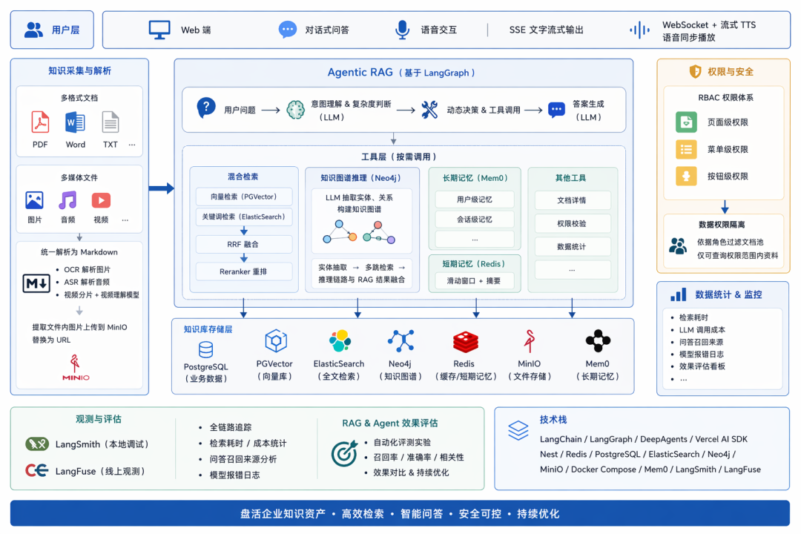

# 企业智能知识库系统 · Agentic RAG

面向企业知识管理场景的 **Agentic RAG** 系统：从「多源文档解析 → 三路索引 → 混合检索 → Agent 问答」的全链路自研实现。

- **后端**：Python · FastAPI · SQLAlchemy(async) · LangChain / LangGraph
- **检索**：PostgreSQL + pgvector（向量）· Elasticsearch（BM25）· Neo4j（知识图谱）· RRF 融合 + Reranker 精排
- **前端**：
- **基础设施**：Docker Compose 一键编排 10 个服务

> 设计文档见 [`AgenticRAG流程.md`](AgenticRAG流程.md)（Agentic RAG 全链路）等。

---

## ✨ 功能

| 模块 | 能力 |
|---|---|
| 文档管理 | 多格式解析（PDF / Word / PPT / Excel / 文本 / **图片 OCR**）→ 统一 Markdown；草稿 / 待审 / 发布 / 归档 审核流 |
| 图像理解 | 图片文件（jpg/png/webp/bmp/gif）走视觉模型（Qwen-VL）OCR / 描述 → Markdown，与文本类文档同一索引链路 |
| 异步流水线 | RabbitMQ 异步消费：解析 → 分块 → **一写三索引**（向量 / 全文 / 图谱） |
| 混合检索 | ES 关键词 + PGVector 向量 双路召回 → RRF 融合 → Reranker 精排 → 阈值过滤 |
| Agent 问答 | LangGraph Agent 自主调度 4 个工具：知识库检索 / 查询改写 / 图谱检索 / 联网搜索 |
| 流式输出 | 自研 AI SDK UI Message Stream 协议（SSE），含思考过程、工具调用、引用来源 |
| 答案溯源 | 强制 `[n]` 引用编号，只回传**实际被引用**的文档分片 |
| 对话记忆 | Redis 短期热窗口 + Mem0 长期记忆 + 跨请求滚动摘要 |
| 知识图谱 | LLM 抽取实体/关系入 Neo4j，全景图可视化 + 对话内图谱检索（带关系出处） |
| 权限体系 | JWT 认证 → 角色守卫 → 权限码守卫，覆盖全部端点；检索侧按 公开/团队/本人 过滤 |

---

## 🏗 架构



```
 ┌──────────────┐
 上传文档 ──────► │ RabbitMQ │ 异步解析流水线
 └──────┬───────┘
 ▼
 解析 → Markdown → 分块(chunk)
 │ 一写三索引
 ┌─────────────┼─────────────┐
 ▼ ▼ ▼
 PGVector Elasticsearch Neo4j
 (向量) (全文/BM25) (知识图谱)
 └─────────────┼─────────────┘
 ▼
 混合检索 (RRF + Rerank)
 ▼
 Agent 循环: retrieve_knowledge / rewrite_query
 / retrieve_graph / web_search
 ▼
 流式作答 + [n] 引用
```

---

## 🚀 快速开始

### 1. 启动基础设施（10 个服务）

```bash
docker compose up -d
```

| 服务 | 端口 | 用途 |
|---|---|---|
| PostgreSQL（pgvector） | 5432 | 业务表 + 向量库 |
| Elasticsearch / Kibana | 9200 / 5601 | 全文检索 |
| MongoDB / mongo-express | 27017 / 8081 | 文档正文 |
| Neo4j | 7474 / 7687 | 知识图谱 |
| Redis | 6379 | 短期记忆 / 会话 |
| RabbitMQ | 5672 / 15672 | 解析队列 |
| RustFS（S3） | 9000 / 9001 | 文件与解析产物 |
| RedisInsight | 5540 | Redis 控制台 |

### 2. 后端

```bash
cd backend
uv sync # 或 pip install -e .
cp .env.example .env # 填入 LLM / Embedding / Rerank API Key
uvicorn app.main:app --reload --port 8000
```

- 接口文档：http://localhost:8000/docs
- 数据库表由 `init-scripts/postgresql` 初始化，种子数据见 `backend/scripts/seed_role_permission_matrix.py`

### 3. 前端

```bash
cd frontend
pnpm install
pnpm dev # http://localhost:5173
```

---

## 📁 目录结构

```
my-rag/
├── backend/
│ ├── app/
│ │ ├── api/v1/ # REST 端点（auth / users / teams / role / permissions
│ │ │ # / document / search / ai / graph / health）
│ │ ├── services/ # 业务服务（检索 / Agent / 记忆 / 图谱 / 索引 / 解析…）
│ │ ├── pipeline/ # 文档管线与共用类型
│ │ ├── models/ schemas/ # ORM 与 Pydantic 模型
│ │ ├── mq/ # RabbitMQ 生产者 / 消费者 / 编排
│ │ └── core/ # 配置 / 日志
│ └── scripts/ # 冒烟脚本 + 重建/回填脚本
├── frontend/
│ └── src/
│ ├── pages/ # 13 个页面（对话 / 检索 / 文档 / 图谱 / 管理…）
│ ├── components/ # 流式渲染 / 图谱 / 引用组件
│ └── api/ # 接口封装
├── db/ init-scripts/ # 建表与初始化
└── docs/ # 架构图与流程图
```

---

## 🔑 核心设计

### 1. 三路索引 + 混合检索

同一份 chunk 并行写入三种索引，避免检索能力割裂：

- **PGVector** 向量（语义泛化）
- **Elasticsearch** 全文（精确匹配：编号、专有名词）
- **Neo4j** 图谱（实体与关系）

检索时双路召回 → **RRF 融合**（只用排名、不依赖两路分数可比）→ 全候选交给 **Reranker 精排**（`qwen3.7-text-rerank`；先截断会丢低排名相关块）→ `minScore` 过滤 → 截 topK。

### 2. Agentic RAG

检索不再是「请求前固定一步」，而是模型可反复调用的工具。Agent 按循环调度：

```
retrieve_knowledge（检索+切题评估）
 ├─ eval.ok → 用文档作答并标 [n]
 └─ insufficient → rewrite_query → 再检索（最多两次）→ 仍不足才 web_search
retrieve_graph（知识图谱实体关系，带关系出处）
```

- 意图路由与「是否切题」用**判别式模型**（TypeSafe）判定，生成式 LLM 只负责改写与作答；
- 检索、改写、图谱都由 Agent 循环自主调度，代码只提供「一步」的原子工具。

### 3. 文档可见性

可见性范围（公开 ∪ 本人 ∪ 所在团队）贯穿**全链路**：文档接口、ES、PGVector、Neo4j 查询都按同一口径过滤，管理端不受限。

### 4. 自研流式协议

按 AI SDK UI Message Stream 协议逐帧编码 SSE（`start` / `data-*` / `source-document` / `text-*` / `reasoning-*` / `finish` / `[DONE]`），支持思考过程、工具调用与引用来源，前端实时渲染。

### 5. 对话记忆

- **短期**：Redis 热窗口（最近 N 条原文）
- **长期**：Mem0 托管记忆（用户/会话两层）
- **滚动摘要**：滑出热窗口的旧历史增量折叠，跨请求持久化

---

## 📡 API 概览

共 **81 个 REST 端点**，按模块：

```
/api/v1/auth 认证 / 激活 / 密码重置
/api/v1/users 用户管理
/api/v1/teams 团队管理
/api/v1/role RBAC 角色
/api/v1/permissions 权限矩阵
/api/v1/document 文档 CRUD / 上传 / 审核 / 发布
/api/v1/search 文档检索 / 混合检索
/api/v1/ai RAG 问答 / 流式对话 / 会话
/api/v1/graph 知识图谱（全景 / 节点 / 边 / 检索）
/api/v1/health 健康检查
```

---

## 📚 文档

- [`AgenticRAG流程.md`](AgenticRAG流程.md) —— Agentic RAG 全链路（意图路由 / 工具循环 / 事件契约 / 前端对接）
- [`长短期记忆.md`](长短期记忆.md) —— 短期热窗口 + 长期记忆 + 滚动摘要
- [`文档可见性与写权限.md`](文档可见性与写权限.md) —— 三层鉴权与可见性口径
- [`发布索引链路.md`](发布索引链路.md) —— 发布后异步索引管线
- [`上传解析模块.md`](上传解析模块.md) —— 多格式解析与资源托管
- [`文档模块CRUD.md`](文档模块CRUD.md) —— 文档模块设计

---

## 📊 检索评测

`backend/eval/rag_eval.jsonl`（**49 正例 + 6 负例**，覆盖 5 篇文档：差旅 / 发布 / 考勤 / 申论 / 简历）+ `backend/scripts/eval_retrieval.py`，指标 `recall@k` / `hit@1` / `MRR` / 负例空召回率，支持扫参数做调参实验：

```bash
cd backend && PYTHONPATH=. RABBITMQ_ENABLED=false .venv/bin/python scripts/eval_retrieval.py [--min-score 0.1] [--no-rerank]
```

**① 阈值校准（55 条评测集 + `qwen3.7-text-rerank`）**：

| minScore | recall@5 | hit@1 | MRR | 负例空召回率 |
| --- | --- | --- | --- | --- |
| 0.1 | 1.00 | 1.00 | 1.00 | 0.00 |
| 0.3 | 1.00 | 1.00 | 1.00 | 0.83 |
| 0.5 | 1.00 | 1.00 | 1.00 | 0.83 |
| 0.55 | 1.00 | 1.00 | 1.00 | 1.00 |
| **0.7（采用）** | **1.00** | **1.00** | **1.00** | **1.00** |
| 0.85 | 0.98 | 0.98 | 0.98 | 1.00 |
| 0.9 | 0.98 | 0.98 | 0.98 | 1.00 |

> 结论：安全区间 **0.55 ~ 0.84** —— 低于 0.55 有负例漏过，高于 0.84 开始误杀合法命中；取中点 **0.7**（两侧各留 ~0.15 余量）。

**② rerank / 阈值各自的作用（29 条早期基线 + `gte-rerank-v2`）**：

| 配置 | recall@5 | hit@1 | MRR | 负例空召回率 |
| --- | --- | --- | --- | --- |
| 混合 + rerank + minScore=0.1 | 1.00 | 1.00 | 1.00 | 1.00 |
| 关闭 rerank | 1.00 | 0.96 | 0.98 | 0.00 |
| minScore=0.4 | 0.28 | 0.28 | 0.28 | 1.00 |
| minScore=0.0 | 1.00 | 1.00 | 1.00 | 0.00 |

> 结论：`minScore=0.4` 会过杀合法命中（recall 掉到 0.28），关闭 rerank 后无关问题不再被过滤（负例空召回率 0.0）—— 印证「rerank + 阈值」是精度关键。

> ⚠️ **`minScore` 与 reranker 模型强耦合，换模型必须重新校准**：表 ① 里 0.1~0.5 的负例漏过，正是把「给 `gte-rerank-v2` 校准的 0.1」直接用到 `qwen3.7-text-rerank` 上的后果——同一评测集、同一个 0.1，负例空召回率 `1.00 → 0.00`。两代模型尺度：`qwen3.7-text-rerank` 相关 ~0.9 / 无关 ~0.001；`gte-rerank-v2` 相关 0.13~0.47 / 无关 ~0.006（且仅免费额度可用，额度耗尽即降级 RRF）。

**chunk size 扫描**（`scripts/sweep_chunk_size.py`，需重建索引，跑完自动恢复原尺寸）：

| chunk / overlap | 块数 | recall@5 | hit@1 | MRR | 负例空召回率 |
| --- | --- | --- | --- | --- | --- |
| 256 / 32 | 24 | 1.00 | 1.00 | 1.00 | 0.75 |
| 512 / 64（默认） | 13 | 1.00 | 1.00 | 1.00 | 1.00 |
| 1024 / 128 | 6 | 1.00 | 1.00 | 1.00 | 1.00 |

> 当前知识库仅 3 篇文档，recall 无法区分尺寸；256 因块更碎、对负例的误召略高（0.75），512/1024 一致。暂保持 512，扩库后重测。

> ⚠️ 上表的 rerank 与 `minScore` 过滤依赖 **DashScope rerank（付费 / 配额资源）**；配额耗尽时检索降级为 RRF（无阈值门控），负例会全部漏过——这一「外部依赖降级」现象也被评测集直接捕捉到。

## ⚠️ 已知边界

- 解析器覆盖文本类格式（PDF / Word / PPT / Excel / 文本）+ **图片 OCR**（Qwen-VL，jpg/png/webp/bmp/gif）；**音频 ASR / 视频理解、以及文档内嵌图片的 OCR 尚未接入**；
- 知识图谱的实体由 LLM 抽取，**存在概率性**（同一文档重抽可能得到不同实体集）；命中不到时以知识库检索（条文）为准；
- 单元测试与 CI 持续完善中（当前以 43 个真实依赖 E2E 冒烟脚本为主）。
