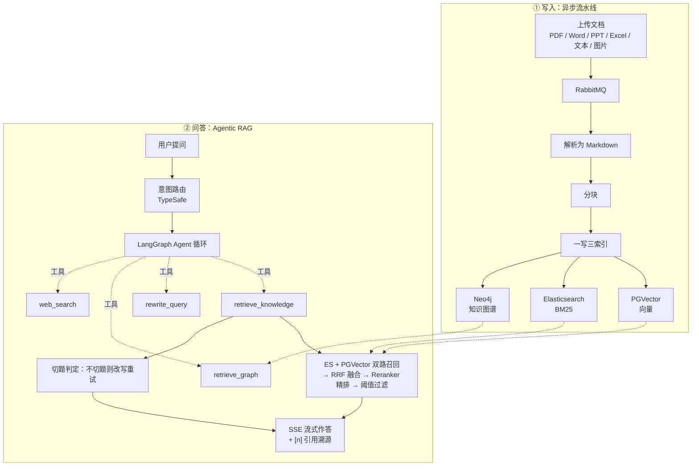

# 企业智能知识库系统 · Agentic RAG

面向企业知识管理场景的 **Agentic RAG** 系统：从「多源文档解析 → 三路索引 → 混合检索 → Agent 问答」的全链路自研实现。

- **后端**：Python · FastAPI · SQLAlchemy(async) · LangChain / LangGraph
- **检索**：PostgreSQL + pgvector（向量）· Elasticsearch（BM25）· Neo4j（知识图谱）· RRF 融合 + Reranker 精排
- **前端**：React · TypeScript · Vite · AI SDK（自研 SSE UI Message Stream 协议）
- **基础设施**：Docker Compose 一键编排（PostgreSQL / Elasticsearch / Neo4j / MongoDB / Redis / RabbitMQ / RustFS / Langfuse）

> 设计文档见 [`AgenticRAG流程.md`](AgenticRAG流程.md)（Agentic RAG 全链路）等。

## 📈 效果与工程数据

> 结论摘要。每一条都能在下方找到完整的**测量过程、埋点与失败案例**。

| 维度 | 实测结果 |
| --- | --- |
| **检索质量** | 132 条评测集 / **174 篇真实语料**。三级消融：难题 `hit@1` **0.524 →（加向量）0.714 →（加兜底门控）0.762 →（加 rerank）0.905** |
| **调参结论** | chunk size 三点**单调且可复现**（256 > 512 > 1024）；`hybrid_top_k` / `rrf_c` 在扩库 12 倍后**仍无差异** → 明确记为「不调」，而不是编一个收益出来 |
| **并发能力** | **100 并发零失败**；峰值 DB 连接 **31 → 2**（根因是 FastAPI 生成器依赖把连接占着等 LLM，不是池太小） |
| **成本可控** | 每轮 token/成本结构化日志；**本地估算与 Langfuse `cost_details` 逐位一致**；Redis 按用户/会话限流（Redis 挂了 fail-open） |
| **可复现性** | 冻结查询向量 → 同一评测集连跑**逐位一致**（根因：embedding 服务端浮点非确定性） |
| **自测出的真问题** | 兜底门控在组合故障下把召回**归零**；`reindex` 共享会话一次崩溃拖死 **74 篇**；3 处结构化输出未判 `None` → 500；`logger.info("...%d", len)` 传函数导致日志永不打印 |

所有数字均由 `backend/scripts/` 下的脚本可复现产出（评测 / 压测 / 参数扫描），不是手写结论。

---

## ✨ 功能

| 模块 | 能力 |
|---|---|
| 文档管理 | 多格式解析（PDF / Word / PPT / Excel / 文本 / **图片 OCR**）→ 统一 Markdown；草稿 / 待审 / 发布 / 归档 审核流 |
| 图像理解 | 图片文件（jpg/png/webp/bmp/gif）走视觉模型（Qwen-VL）OCR / 描述 → Markdown，与文本类文档同一索引链路 |
| 异步流水线 | RabbitMQ 异步消费：解析 → 分块 → **一写三索引**（向量 / 全文 / 图谱） |
| 混合检索 | ES 关键词 + PGVector 向量 双路召回 → RRF 融合 → Reranker 精排 → 阈值过滤 |
| Agent 问答 | LangGraph Agent 自主调度 4 个工具：知识库检索 / 查询改写 / 图谱检索 / 联网搜索 |
| 流式输出 | 自研 AI SDK UI Message Stream 协议（SSE），含思考过程、工具调用、引用来源 |
| 答案溯源 | 强制 `[n]` 引用编号，只回传**实际被引用**的文档分片 |
| 对话记忆 | Redis 短期热窗口 + Mem0 长期记忆 + 跨请求滚动摘要 |
| 知识图谱 | LLM 抽取实体/关系入 Neo4j，全景图可视化 + 对话内图谱检索（带关系出处） |
| 权限体系 | JWT 认证 → 角色守卫 → 权限码守卫，覆盖全部端点；检索侧按 公开/团队/本人 过滤 |

---

## 🏗 架构

> 用 mermaid 而不是 PNG：能进 diff、不会像图片那样默默过期。



---

## 🚀 快速开始

### 1. 启动基础设施（10 个服务）

```bash
docker compose up -d
```

| 服务 | 端口 | 用途 |
|---|---|---|
| PostgreSQL（pgvector） | 5432 | 业务表 + 向量库 |
| Elasticsearch / Kibana | 9200 / 5601 | 全文检索 |
| MongoDB / mongo-express | 27017 / 8081 | 文档正文 |
| Neo4j | 7474 / 7687 | 知识图谱 |
| Redis | 6379 | 短期记忆 / 会话 |
| RabbitMQ | 5672 / 15672 | 解析队列 |
| RustFS（S3） | 9000 / 9001 | 文件与解析产物 |
| RedisInsight | 5540 | Redis 控制台 |

### 2. 后端

```bash
cd backend
uv sync # 或 pip install -e .
cp .env.example .env # 填入 LLM / Embedding / Rerank API Key
uvicorn app.main:app --reload --port 8000
```

- 接口文档：http://localhost:8000/docs
- 数据库表由 `init-scripts/postgresql` 初始化，种子数据见 `backend/scripts/seed_role_permission_matrix.py`

### 3. 前端

```bash
cd frontend
pnpm install
pnpm dev # http://localhost:5173
```

---

## 📁 目录结构

```
my-rag/
├── backend/
│ ├── app/
│ │ ├── api/v1/ # REST 端点（auth / users / teams / role / permissions
│ │ │ # / document / search / ai / graph / health）
│ │ ├── services/ # 业务服务（检索 / Agent / 记忆 / 图谱 / 索引 / 解析…）
│ │ ├── pipeline/ # 文档管线与共用类型
│ │ ├── models/ schemas/ # ORM 与 Pydantic 模型
│ │ ├── mq/ # RabbitMQ 生产者 / 消费者 / 编排
│ │ └── core/ # 配置 / 日志
│ └── scripts/ # 冒烟脚本 + 重建/回填脚本
├── frontend/
│ └── src/
│ ├── pages/ # 13 个页面（对话 / 检索 / 文档 / 图谱 / 管理…）
│ ├── components/ # 流式渲染 / 图谱 / 引用组件
│ └── api/ # 接口封装
├── db/ init-scripts/ # 建表与初始化
└── docker-compose.langfuse.yml # 自托管 Langfuse（trace + 成本看板，独立栈）
```

---

## 🔑 核心设计

### 1. 三路索引 + 混合检索

同一份 chunk 并行写入三种索引，避免检索能力割裂：

- **PGVector** 向量（语义泛化）
- **Elasticsearch** 全文（精确匹配：编号、专有名词）
- **Neo4j** 图谱（实体与关系）

检索时双路召回 → **RRF 融合**（只用排名、不依赖两路分数可比）→ 全候选交给 **Reranker 精排**（`qwen3.7-text-rerank`；先截断会丢低排名相关块）→ `minScore` 过滤 → 截 topK。

### 2. Agentic RAG

检索不再是「请求前固定一步」，而是模型可反复调用的工具。Agent 按循环调度：

```
retrieve_knowledge（检索+切题评估）
 ├─ eval.ok → 用文档作答并标 [n]
 └─ insufficient → rewrite_query → 再检索（最多两次）→ 仍不足才 web_search
retrieve_graph（知识图谱实体关系，带关系出处）
```

- 意图路由与「是否切题」用**判别式模型**（TypeSafe）判定，生成式 LLM 只负责改写与作答；
- 检索、改写、图谱都由 Agent 循环自主调度，代码只提供「一步」的原子工具。

### 3. 文档可见性

可见性范围（公开 ∪ 本人 ∪ 所在团队）贯穿**全链路**：文档接口、ES、PGVector、Neo4j 查询都按同一口径过滤，管理端不受限。

### 4. 自研流式协议

按 AI SDK UI Message Stream 协议逐帧编码 SSE（`start` / `data-*` / `source-document` / `text-*` / `reasoning-*` / `finish` / `[DONE]`），支持思考过程、工具调用与引用来源，前端实时渲染。

### 5. 对话记忆

- **短期**：Redis 热窗口（最近 N 条原文）
- **长期**：Mem0 托管记忆（用户/会话两层）
- **滚动摘要**：滑出热窗口的旧历史增量折叠，跨请求持久化

---

## 🎯 设计取舍

> 这一节记录**四个用数据做出来的决定**（含一个自己踩出来的 bug）。面试里比「我用了什么技术」更值得讲的，就是这类取舍。

### 1. 向量 / rerank 到底值多少钱？—— 三级消融

不看「别人都说要上 rerank」，而是把通道一级级关掉，量出每一级的边际收益（难题 = 近义改写题，`hit@1`）：

| 阶梯 | 难题 hit@1 | 边际增量 |
| --- | --- | --- |
| 纯关键词（BM25） | 0.524 | — |
| + 向量召回（混合） | 0.714 | **+0.190** |
| + 降级兜底门控 | 0.762 | +0.048 |
| + rerank | 0.905 | **+0.143** |

**为什么要这样测**：只报「加了 rerank 后指标 1.00」回答不了「不加会怎样」。把每一级单独关掉，才有可比较的基线。

### 2. 指标饱和时，调参就是自欺 —— 为什么要扩库

最初知识库只有 5 篇**互不相似**的文档，`hybrid_top_k` / `rrf_c` / `minScore` 怎么扫都接近满分。这不是「参数调好了」，而是**评测集没有区分度**。

于是造了 8 篇**强干扰语料**（同领域、词汇重叠、数字不同）：会议费用 vs 差旅、数据库变更 SOP vs 发布 SOP、干扰简历 vs 真简历……扩到 14 篇后指标才出现真实梯度。

> 即便如此，`hybrid_top_k` / `rrf_c` 扫下来仍只差 1 条题 —— 我把它记为「无差异」而不是「调出收益」。**没有收益就不编收益。**

### 3. 组合故障：我的兜底把系统搞挂了

rerank 不可用时，我加了「用向量相似度兜底过滤」。单看没问题。但**向量通道也挂掉时**（同一账号欠费），`vectorScore` 全是 0 → 兜底门控把**全部候选滤空**：

```
rerank 挂 → 用向量分兜底
向量也挂 → 向量分全 0 → 把候选全滤掉 → 检索召回 0.94 → 0.00（比不兜底还差）
```

修法：**没有数据就别做数据驱动的判断** —— 检测到向量通道无数据时跳过兜底、退回 RRF 原序。

> 这个 bug 是**被自己加的降级告警逼出来的**：先给 rerank 加了失败提示，然后想「向量挂了会不会也静默」，查下去才发现兜底把召回清零了。**可观测性不是为了好看，是为了能发现自己刚写错的代码。**

### 4. 评测数字会飘 —— 定位到 embedding 后冻结查询向量

同一份评测集连跑 3 次，`hit@1` 在 0.889 / 0.901 之间跳。定位过程本身就是方法：

1. 先怀疑 ES 同分排序 → 给 RRF 加 `chunk_id` 确定性 tie-break（顺手修了，但**不是根因**）；
2. **做对照实验**：纯关键词（`--no-vector`）连跑 3 次**完全一致**，含向量就飘 → 锅在向量通道；
3. 再怀疑 pgvector HNSW 近似检索 → 把 `ef_search` 提到 200，**仍然飘**；
4. 直接测 embedding API：**同一段文本两次调用，1024 维里有 1017 维不同**（最大差 6e-3）—— 服务端浮点非确定性，这才是根因。

修法：查询向量**缓存 + 落盘冻结**（`eval/query_vectors.json`，已 gitignore）。收益是三份的：

- 评测可复现（连跑 4 次数字完全一致）；
- 生产上重复查询直接命中缓存，省一次嵌入调用；
- 副产品：`--no-rerank` 的离线消融**不再依赖任何付费 API**，CI 里也能跑。

### 5. 成本与限流：先有可观测，才谈得上控制

项目里所有 LLM 调用（agent 主循环、检索改写、切题判定、长期记忆分类、会话摘要、KG 抽取、图像 OCR）此前**既没有用量统计、也没有预算控制**。实测中被账号欠费中断两次后，才补上这一层。

**成本核算**：usage handler 挂在 **LLM 构造器**上（8 个构造点 + 3 个继承它的 `with_structured_output` 派生器），而不是逐个改 `invoke` —— 后者调用点更多且会持续新增。一轮问答里，agent 主循环与工具内部的子调用（改写 / 切题）会累加到同一个累加器（`ContextVar`），轮次结束打一条结构化日志：

```
本轮 LLM 用量：sessionId=759..., {'llmCalls': 6, 'promptTokens': 18432,
  'completionTokens': 1207, 'totalTokens': 19639, 'estimatedCostYuan': 0.046}
```

**限流**：Redis 计数「每用户 / 每会话每日轮次」（默认 200 / 100，`0` = 不限制），超限在**开始推流前**返回 429（而不是 200 + SSE 错误事件——后者对前端语义很别扭）。

三条刻意的取舍：

| 取舍 | 理由 |
| --- | --- |
| token 取真实值，金额是**估算** | 单价随厂商调整；日志字段带 `estimated`，只用于发现异常用量，不作为账单 |
| 按「**轮**」限，不按 token 限 | 用户能理解、实现简单，且不会因为一次长上下文就误杀正常用户 |
| Redis 不可用时 **fail-open** | 限流是保护措施，不该成为新的单点故障（与项目里 ES / Neo4j 的降级风格一致） |

> 验证方式：单元测试 14 例（成本换算 / 双形态 token 提取 / handler 上下文隔离 / 配额各分支），
> 外加一个**本地 mock 的 OpenAI 兼容服务**做端到端验证 —— 确认「构造器挂 callbacks → handler 被触发 → token 正确累加」。**不花钱也能验**。

### 6. 并发压测：真问题不是连接池太小，是连接被占着等 LLM

项目原本**一个生产数字都没有**：「并发多少会挂」是面试必问却答不上来的题。

**方法**：mock 掉 LLM / Embedding，起一个独立实例，N 路并发打 `/ai/chat`，后台采样 `pg_stat_activity`。
先把第三方 API 的抖动移除——压测要测的是**我的系统**，而且这样不花钱、可复现、能进 CI。

```bash
cd backend && PYTHONPATH=. RABBITMQ_ENABLED=false \
    .venv/bin/python scripts/load_test.py --levels 10,20,40,60
```

**第一轮（池 = 5 + 10 = 15）**：并发 10 正常，**并发 20 时 5/20 失败**，p50 从 0.5s 直接跳到 **31s**（正好是 `pool_timeout`）。

抓异常（而不是猜）——服务端日志里拿到确凿的一行：

```
sqlalchemy.exc.TimeoutError: QueuePool limit of size 5 overflow 10 reached,
connection timed out, timeout 30.00
```

**但我没有直接去调大连接池**，而是先问：连接被**谁**占着、占了**多久**？给采样器加上状态分布：

```
峰值时刻连接状态：idle in transaction=20, idle=11, active=1
空占连接的最后一条 SQL（= 谁开的会话）：
  ×7  SELECT kh_role.role_code FROM kh_role JOIN kh_user_role ...
```

**31 条连接里 20 条在「开着事务空等」，真正跑查询的只有 1 条。**

**根因**：FastAPI 的生成器依赖 `Depends(get_db_session)` 会活到**响应结束**（流式就是整个流）。
权限守卫用了它，于是一次权限查询开的**会话 / 事务 / 连接被占住整条链路** —— 包括后面几秒的检索与 LLM 生成。

**修法**（两处，都不涉及调池）：

1. `permission_guard` 改用**短生命周期会话**（查完就还连接）；
2. 后台摘要 `fold` 把 LLM 调用**移出 `async with` 会话块**（原来等模型时一直占着连接）。

**结果**：

| 并发 | 修复前（池 15） | 仅调大池（30） | **修掉跨调用持有** |
| --- | --- | --- | --- |
| 10 | 10/0 | 10/0 | **10/0** |
| 20 | **15/5 失败** | 20/0 | **20/0** |
| 40 | 15/25 | 32/8 | **40/0** |
| 60 | 15/45 | 37/23 | **60/0** |
| 100 | — | — | **100/0** |
| **峰值连接** | 16 | 31 | **2** |

> **教训：先查「连接持有时间」，再谈「池容量」。** 加池只是把「占着等」的容量买大一点，
> 峰值从 2 变成 31 却仍在 40 并发崩；修掉持有问题后，100 并发峰值也只要 **2 条**。

**顺手拈出 3 个真 bug**（都是压测/日志才暴露的）：

| Bug | 后果 |
| --- | --- |
| `chat_query_rewrite` 两处结构化输出未判 `None` | `with_structured_output` 在模型未吐出合法 tool call 时返回 None（**不抛异常**）→ `result.query` 抛 AttributeError → 整轮 500 |
| `kg_extraction` 同样未判 `None` | 抽取失败会让建图整批断掉 |
| `graph_build` 的 `logger.info("...count=%d", len)` | 传了 `len` 函数本身 → 日志行**永远不打印**（TypeError 被 logging 吞掉），纯粹的可观测黑洞 |

> 边界：单进程、mock LLM、本开发机实测；关注的不是绝对延迟，而是**能承受的并发与峰值连接**。

## 📡 API 概览

共 **81 个 REST 端点**，按模块：

```
/api/v1/auth 认证 / 激活 / 密码重置
/api/v1/users 用户管理
/api/v1/teams 团队管理
/api/v1/role RBAC 角色
/api/v1/permissions 权限矩阵
/api/v1/document 文档 CRUD / 上传 / 审核 / 发布
/api/v1/search 文档检索 / 混合检索
/api/v1/ai RAG 问答 / 流式对话 / 会话
/api/v1/graph 知识图谱（全景 / 节点 / 边 / 检索）
/api/v1/health 健康检查
```

---

## 📚 文档

- [`AgenticRAG流程.md`](AgenticRAG流程.md) —— Agentic RAG 全链路（意图路由 / 工具循环 / 事件契约 / 前端对接）
- [`长短期记忆.md`](长短期记忆.md) —— 短期热窗口 + 长期记忆 + 滚动摘要
- [`文档可见性与写权限.md`](文档可见性与写权限.md) —— 三层鉴权与可见性口径
- [`发布索引链路.md`](发布索引链路.md) —— 发布后异步索引管线
- [`上传解析模块.md`](上传解析模块.md) —— 多格式解析与资源托管
- [`文档模块CRUD.md`](文档模块CRUD.md) —— 文档模块设计

---

## 🗂 知识库与语料

知识库共 **174 篇文档 / 467 块**（512 chunk 配置下）：

| 来源 | 篇数 | 说明 |
| --- | --- | --- |
| **公开语料**（`eval/corpus_oss/`） | 160 | `jaywcjlove/linux-command`（MIT，37k stars）的中文 Linux 命令手册 —— **真实文档**，不是自编 |
| 自写演示语料（`eval/corpus/`） | 8 | 刻意与原始文档组成的强干扰对（见下表） |
| 原始演示文档 | 6 | 差旅 / 发布 SOP / 考勤表 / 申论 / 简历×2 |

**为什么引入公开语料**：评测集的说服力取决于语料是否真实。合成语料能测「逻辑对不对」，
但经不起面试里的那句追问：「这 14 篇是不是你自己写的？」
而且 Linux 命令手册**天然成簇、互为强干扰** —— `arp`/`arping`/`arptables`/`arpwatch`、
`at`/`atq`/`atrm`/`batch`、`chmod`/`chown`/`chgrp`/`chattr`/`chcon`/`chroot` ……
这正是把 `hit@1` 拉开的必要条件。

```bash
# 抓取公开语料（结果目录已 gitignore：体积 + 不让仓库混入第三方内容）
cd backend && PYTHONPATH=. .venv/bin/python scripts/fetch_oss_corpus.py --limit 160
# 导入任意语料目录（幂等：已存在则跳过，不白烧 embedding）
PYTHONPATH=. RABBITMQ_ENABLED=false .venv/bin/python scripts/seed_demo_corpus.py --dir eval/corpus_oss
```

> **扩库的效果是真实的**：从 14 篇扩到 174 篇后，之前掉不下去的指标终于出现梯度，
> 且失败案例可解释 —— `想让任务等到系统空闲时再跑` 被同簇的 `at` 抢走（正确是 `batch`）；
> 简历题被 `cd`/`gdb` 这类短文档淹没，从第 1 掉到第 5 位。

### 自写的 8 篇强干扰语料

**为什么要有合成语料**：评测集要拉开区分度，前提是库里有**强干扰项** —— 同领域、词汇重叠、数字不同的文档：

| 新语料 | 与谁抢 | 重叠点 |
| --- | --- | --- |
| 会议与培训费用管理办法 | 差旅与费用报销管理办法 | 住宿上限、餐费包干、发票抬头、Leader 审批 |
| 数据库变更管理规范（SOP） | 生产环境变更发布流程（SOP） | 变更窗口、封网期、审批、灰度、回滚 |
| 考勤与请休假管理办法 | 员工考勤表 | 上下班时间、打卡、迟到 |
| 行测数量关系总结课 | 申论总结课 | 同类「公考总结课」体裁 |
| 王磊_后端开发 | 梁多强_Agent 开发 | 同类简历体裁，都有「求职意向 / 项目经历」 |

这 8 篇是**演示数据**，不是真实制度，不要据此执行任何公司流程。导入 / 回滚：

```bash
cd backend && PYTHONPATH=. RABBITMQ_ENABLED=false .venv/bin/python scripts/seed_demo_corpus.py [--wipe]
```

> **实测效果**：扩库前（5 篇）所有参数指标都是 1.00；扩库后（14 篇）终于出现真实梯度 —— 简历题会被「干扰简历」抢走、发布 SOP 题会被「数据库变更 SOP」抢走。

## 📊 检索评测

`backend/eval/rag_eval.jsonl`（**120 正例 + 12 负例**，覆盖 174 篇文档；其中 **51 条难例**、**39 条公开语料题**、**15 条交叉混淆题**）+ `backend/scripts/eval_retrieval.py`，指标 `recall@k` / `hit@1` / `MRR` / 负例空召回率，支持按难度分组、列「命中但未排第 1」的题、扫参数做调参实验：

```bash
# 改完评测集/换完语料先跑这个：校验期望文档标题存在、期望要点能在对应文档里找到
#（防止「标题打错 → 该题永远失败 → 指标骗人」这类隐蔽错误）
PYTHONPATH=. RABBITMQ_ENABLED=false .venv/bin/python scripts/validate_eval_set.py
```

```bash
cd backend && PYTHONPATH=. RABBITMQ_ENABLED=false .venv/bin/python scripts/eval_retrieval.py [--min-score 0.1] [--no-rerank]
```

**① 阈值校准（81 正 + 12 负，`qwen3.7-text-rerank`）**：

| minScore | recall@5 | hit@1 | MRR | 负例空召回率 |
| --- | --- | --- | --- | --- |
| 0.1 | 1.000 | 0.975 | 0.988 | **0.00** |
| 0.3 | 1.000 | 0.975 | 0.988 | 0.58 |
| 0.5 | 1.000 | 0.975 | 0.988 | 0.92 |
| 0.6 | 1.000 | 0.975 | 0.988 | 1.00 |
| **0.7（采用）** | **1.000** | **0.975** | **0.988** | **1.00** |
| 0.8 | 0.963 | 0.938 | 0.951 | 1.00 |
| 0.9 | 0.914 | 0.889 | 0.901 | 1.00 |

> 安全区间 **[0.6, 0.8)**：低于 0.6 有负例漏过，0.8 起开始误杀合法命中。**0.7 正好是区间中点**（两侧各留 0.1 余量）。

**①' 174 篇文档下的完整消融**（132 条评测集）：

| 配置 | recall@5 | hit@1 | MRR | easy hit@1 | hard hit@1 | 负例空召回率 |
| --- | --- | --- | --- | --- | --- | --- |
| 混合 + rerank | 0.992 | 0.975 | 0.983 | 1.000 | 0.941 | 1.00 |
| 纯混合（无 rerank） | 1.000 | 0.900 | 0.940 | 0.957 | **0.824** | 0.00 |

> 扩库前（14 篇）所有配置都接近满分；扩到 174 篇后 `hard hit@1` 终于分开（0.824 vs 0.941）。

**② rerank / 阈值各自的作用（29 条早期基线 + `gte-rerank-v2`）**：

| 配置 | recall@5 | hit@1 | MRR | 负例空召回率 |
| --- | --- | --- | --- | --- |
| 混合 + rerank + minScore=0.1 | 1.00 | 1.00 | 1.00 | 1.00 |
| 关闭 rerank | 1.00 | 0.96 | 0.98 | 0.00 |
| minScore=0.4 | 0.28 | 0.28 | 0.28 | 1.00 |
| minScore=0.0 | 1.00 | 1.00 | 1.00 | 0.00 |

> 结论：`minScore=0.4` 会过杀合法命中（recall 掉到 0.28），关闭 rerank 后无关问题不再被过滤（负例空召回率 0.0）—— 印证「rerank + 阈值」是精度关键。

> ⚠️ **`minScore` 与 reranker 模型强耦合，换模型必须重新校准**：表 ① 里 0.1~0.5 的负例漏过，正是把「给 `gte-rerank-v2` 校准的 0.1」直接用到 `qwen3.7-text-rerank` 上的后果——同一评测集、同一个 0.1，负例空召回率 `1.00 → 0.00`。两代模型尺度：`qwen3.7-text-rerank` 相关 ~0.9 / 无关 ~0.001；`gte-rerank-v2` 相关 0.13~0.47 / 无关 ~0.006（且仅免费额度可用，额度耗尽即降级 RRF）。

**③ 三级消融**（叙事见「设计取舍」第 1 节；难题 = 21 条近义改写题，刻意避开目标文档词汇让 BM25 失效）：

| 配置 | 分组 | recall@5 | hit@1 | MRR |
| --- | --- | --- | --- | --- |
| 纯关键词（`--no-vector`） | easy（60） | 0.983 | 0.950 | 0.967 |
| 纯关键词（`--no-vector`） | hard（21） | 0.810 | **0.524** | 0.659 |
| 纯混合（`--no-rerank --min-score 0`） | easy（60） | 1.000 | 0.950 | 0.972 |
| 纯混合（`--no-rerank --min-score 0`） | hard（21） | 0.952 | **0.714** | 0.810 |
| + 降级兜底门控（`--no-rerank`） | hard（21） | 0.952 | **0.762** | 0.841 |
| 混合 + rerank（默认） | easy（60） | 1.000 | 1.000 | 1.000 |
| 混合 + rerank（默认） | hard（21） | 1.000 | **0.905** | 0.952 |

> 🔍 失败是可解释的，不是噪声：`线上出故障要紧急动手，得谁点头才行？` 被「数据库变更管理规范」抢到第 1（两者都有「紧急窗口 + 审批」）；`这个人想找什么方向的工作？` 被「王磊简历」抢走（同类简历都写「求职意向」）。

**④ rerank 降级兜底（`RAG_MIN_VECTOR_SCORE`）**：rerank 不可用（配额 / 网络 / 未配 Key）时，原实现直接返回 RRF 顺序，`minScore` 整体失效——无关问题全部漏进来。改为用**向量余弦相似度**兜底：

| 场景 | recall@5 | hit@1 | MRR | 负例空召回率 |
| --- | --- | --- | --- | --- |
| rerank 正常（minScore=0.7） | 1.000 | 0.975 | 0.988 | 1.00 |
| rerank 降级（**无兜底**） | 0.988 | 0.889 | 0.930 | **0.00** |
| rerank 降级（**兜底 0.35**） | 0.988 | 0.901 | 0.938 | 0.42 |

> ⚠️ 这个门槛是**精度 / 召回旋钮**，没有「两全」的取值（关闭 rerank，按难度拆分）：

| 门槛（`--min-vector-score`） | recall@5 | hit@1 | 负例空召回率 |
| --- | --- | --- | --- |
| 0.30 | 0.988 | 0.889 | 0.00 |
| **0.35（采用）** | 0.988 | 0.901 | **0.42** |
| 0.40 | 0.889 | 0.827 | 0.83 |

> 教训：`0.37` 是最初**只按简单题**标定出的值，加入近义改写难题后暴露**过拟合**——难题正确命中的向量分最低仅 0.28，会被误杀。降级是异常路径，宁可多放噪声也不能漏真命中，故取 0.35。**这是兜底，不是 reranker 的等价替代。**

**⑤ hybrid_top_k / rrf_c 扫描**（**174 篇文档下重测**，`--no-rerank --min-score 0`）：

| 参数 | 取值 | recall@5 | hit@1 | MRR |
| --- | --- | --- | --- | --- |
| `--hybrid-top-k` | 5 / 10 / 20 / 40 | 1.000 | 0.900 | 0.940 |
| `--rrf-c` | 10 | 1.000 | 0.900 | **0.942** |
| `--rrf-c` | 30 / 60 / 100 | 1.000 | 0.900 | 0.940 |

> 这是本项目**第二个「扩库后重测」的结论，也是第二个「无差异」**：语料从 14 篇扩到 174 篇
> （12 倍，且近义文档成堆），`hybrid_top_k` 依旧完全无影响，`rrf_c=10` 只高 0.002 MRR。
> **记为「无差异」而不是「调出收益」** —— 没有收益就不编收益。

**chunk size 扫描**（`scripts/sweep_chunk_size.py`；重建索引后评测，跑完自动恢复原尺寸）：

**174 篇文档下重测**（同一批 132 条用例、同一份冻结查询向量；**每档都重复了一次**）：

| chunk / overlap | 块数 | recall@5 | hit@1 | MRR | 负例空召回率 | 复现 |
| --- | --- | --- | --- | --- | --- | --- |
| **256 / 32** | 883 | **1.000** | **0.992** | **0.996** | 1.00 | ✅ 两次逐位一致 |
| 512 / 64（默认） | 467 | 0.992 | 0.975 | 0.983 | 1.00 | ✅ 两次逐位一致 |
| 1024 / 128 | 274 | 0.992 | 0.967 | 0.979 | 1.00 | 单次 |

> **这是三个悬案里唯一出现差异的一个，而且三点单调**：块越小，`hit@1` / `MRR` 越高
> （0.992 → 0.975 → 0.967）。单调 + 可复现说明**不是随机噪声，是真实的方向性效应**：
> 块越小，向量匹配越精确。机制上也说得通 —— 块数从 274 → 883，候选更细。

> ⚠️ **但我没有改默认值**，理由要说清楚：
> 1. **幅度很小**：相邻两档只差 1~2 条题（120 条里），换一批问句就可能翻过来；
> 2. **代价不小**：256 的索引是 512 的 **1.9 倍**（883 vs 467 块）—— 嵌入成本、存储、
>    rerank 候选量都随之上升；
> 3. **评测集只有 120 条正例**，不足以支撑一个「拿成本换 1~2 条题」的生产决策。
>
> 结论：**保持 512，并把这个权衡记录下来**。要真正定案，需要把评测集扩到几百条、
> 或者做多组问句重采样看效应是否稳定。

> 🛠 脚本在环境故障下的容错是刻意设计的，而且**被这轮真实故障验证了**：
> 开跑前 embedding 预检；单档失败**跳过而非中断**；恢复**每次开全新会话 + 重试 3 次**；
> 结束**比对基线块数**（本轮两次都打印了「✅ 恢复校验通过：块数回到基线 467」）。
> 另：`reindex_document` 是「先嵌入、后删旧块」，单篇失败不会留下检索空窗。

> 🐛 **同轮修掉一个真问题**：`reindex_all_chunks.py` 原先 174 篇共用一个 DB 会话，
> PG 一崩这个会话就永久失效 —— 实测一次崩把后面 **74 篇**全部拖死，索引被留在混合尺寸。
> 改成**每篇独立会话 + 重试 3 次**后，同样条件下只失败 **1 篇**（再跑一遍即收敛）。

> ⚠️ rerank 与 `minScore` 依赖 **DashScope（付费 / 配额）**；配额耗尽时检索降级为 RRF（阈值失效、负例全过）。这类「外部依赖降级」已被评测集与降级告警直接捕捉到。

## 🧪 生成侧评测（忠贞度 / 引用准确率）

检索指标只回答「资料有没有被找到」—— **检索全对但模型编造、乱标引用，检索指标一样满分**。`eval/gen_eval.jsonl`（12 条：10 可回答 + 2 不可回答）+ `scripts/eval_generation.py` 补上回答质量：

| 指标 | 类型 | 含义 | 实测 |
| --- | --- | --- | --- |
| 要点覆盖率 | 确定性 | 答案里出现了多少期望要点 | 1.00 |
| 引用率 | 确定性 | 多少比例的回答带了 `[n]` 引用 | 1.00 |
| 引用越界率 | 确定性 | `[n]` 的 n 超出资料条数 | 0.00 |
| 拒答率 | 确定性 | 不可回答问题中正确说「没有相关内容」的比例 | 1.00 |
| 忠贞度 | LLM 判分 | 答案断言中被检索资料支撑的比例 | 1.00 |
| 引用准确率 | LLM 判分 | `[n]` 是否指向真正支持该句的资料 | 1.00 |

```bash
cd backend && PYTHONPATH=. RABBITMQ_ENABLED=false .venv/bin/python scripts/eval_generation.py [--limit 5] [--no-judge]
```

> **一次真实的判分踩坑**：首轮「引用准确率」只有 0.80，两条被判「引用错配」。手工核对后发现**引用本来就是对的** —— 判分器把 `[1]` 理解成「资料里的小节」，而 `[1]` 实际是**整块 961 字的 chunk**（同时含 5.2 灰度与 5.4 回滚）。把判分口径写清「编号指向整段原文」后回到 1.00。
> 教训：**LLM 判分器本身也要被验证**，否则会拿错指标做决策（这次是靠人工抽查发现的）。

> ⚠️ 12 条全满分说明**区分度仍有限**（与检索侧同一个教训：小集子会饱和）。这一步的真正价值是**建立了指标与判分链路**，而不是「证明系统完美」。

## 🔭 可观测（Langfuse 自托管）

```
控制面（authoritative）  进程内 + Redis      ← 限流：同步、强一致、CI 可测
观测面（analytical）     Langfuse（自托管）   ← trace 下钻 + 成本看板：异步旁路，挂了不影响对话
```

**为什么自托管**：数据不出本机、不依赖 SaaS 配额（本项目已因外部额度耗尽被中断两次）。
代价是自托管 = 跑 Langfuse 自己的生产架构：**ClickHouse**（Trace / Observation / Score 的 OLAP 主存储）
+ Postgres + Redis + S3（复用已有的 RustFS 生态思路，但独立栈更省心）。

> ⚠️ **内存代价是实测的，不是估算**：整个栈约 **2.6 GB**（ClickHouse 1.2 GB +
> web/worker 1.2 GB + MinIO 0.1 GB + PG/Redis 0.06 GB）。本机 Docker VM 只有 7.7 GB
> 却跑了 16 个容器，加上它后 **PostgreSQL 后端进程被 OOM 杀掉**、进入 crash recovery。
> 所以推荐**按需启停**（`docker compose ... stop` / `up -d`），或调大 Docker 内存限额。

```bash
# 启动（独立 project，只对外暴露 3000；存储组件走内部网络，避开主栈 5432/6379/9000）
docker compose --env-file .env.langfuse -f docker-compose.langfuse.yml up -d
# ⚠️ 必做：注册本项目模型单价，否则 Langfuse 不认 deepseek-v4-flash 这类别名 → 成本恒为 0
cd backend && PYTHONPATH=. .venv/bin/python scripts/setup_langfuse_models.py
```

**接入方式**：Langfuse handler 与本地用量统计挂在**同一处**（`llm_budget.usage_callbacks()`），
即 8 个 LLM 构造点自动全覆盖；未配 `LANGFUSE_*` 时完全不加载（零开销，CI 不受影响）。
两者是**互补而非替代**：Langfuse 挂了本地照常统计，也只有本地那套能在不连外部服务时断言成本。

**验证过的两件事**：

| 事项 | 结果 |
| --- | --- |
| trace 是否真的入库 | ClickHouse `events_full` 出现 `GENERATION / ChatOpenAI`，`usage_details={'input':111,'output':22,'total':133}` |
| 成本口径是否一致 | 本地估算 `0.000398 元` ≡ Langfuse `cost_details.total=0.000398`（两条独立计算路径吻合） |

> **踩坑记录（已写进脚本注释）**：Langfuse 只认内置价格表里的模型。不注册别名时，
> 它照常记录 token 用量，但 `cost_details` 是**空的**、成本看板恒为 0 —— 实测确认过：
> `usage_details={'input':1234,...}` 而 `cost_details={}`。
> 另外 Langfuse 的 `inputPrice` 是**单 token 价**（内置 babbage-002 为 `4e-07`，即 $0.4/1M），不是「每百万」。

## ⚠️ 已知边界

- 解析器覆盖文本类格式（PDF / Word / PPT / Excel / 文本）+ **图片 OCR**（Qwen-VL，jpg/png/webp/bmp/gif）；**音频 ASR / 视频理解、以及文档内嵌图片的 OCR 尚未接入**；
- 知识图谱的实体由 LLM 抽取，**存在概率性**（同一文档重抽可能得到不同实体集）；命中不到时以知识库检索（条文）为准；
- 单元测试与 CI 持续完善中（62 个纯逻辑用例 + 真实依赖 E2E 冒烟脚本）。
- 生成侧评测集仅 12 条且全满分，**区分度有限**；待补「资料部分相关 / 多跳」类用例。
- 限流按「轮次」而非 token/金额：一次超长上下文（如长文档问答）仍会消耗较多额度，目前靠成本日志发现、人工干预。
- 压测结论基于**单进程 + mock LLM + 本开发机**；多 worker 部署需重测（部署前记得按 `DB_POOL_SIZE + DB_MAX_OVERFLOW` 与 PG `max_connections` 算账）。
